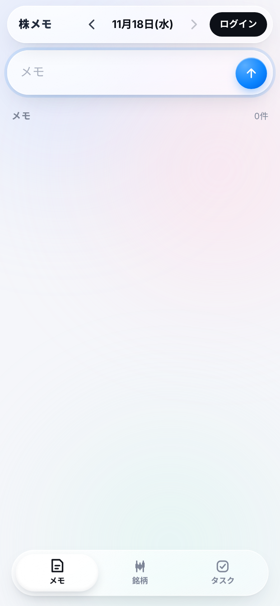
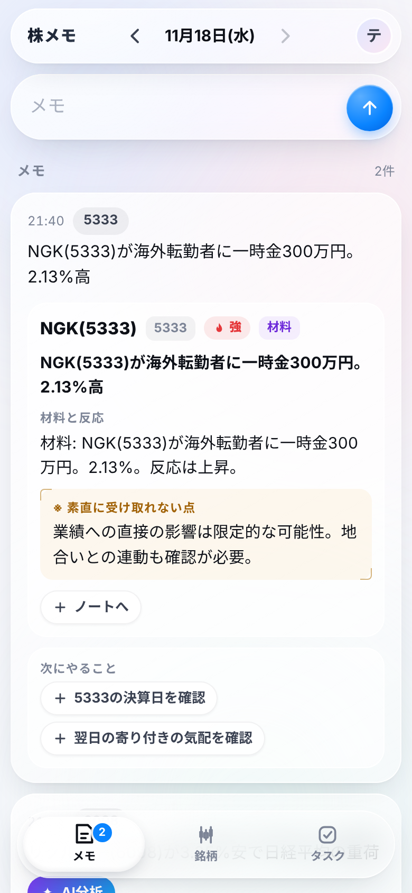
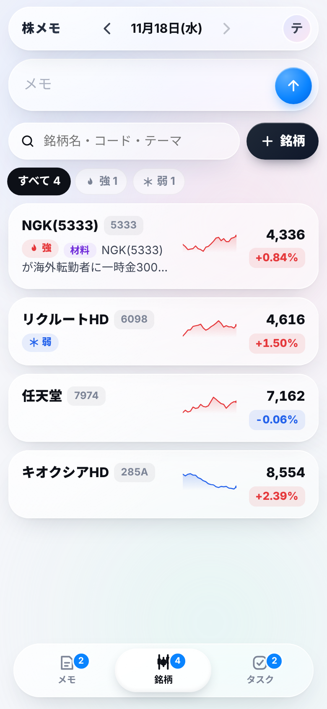
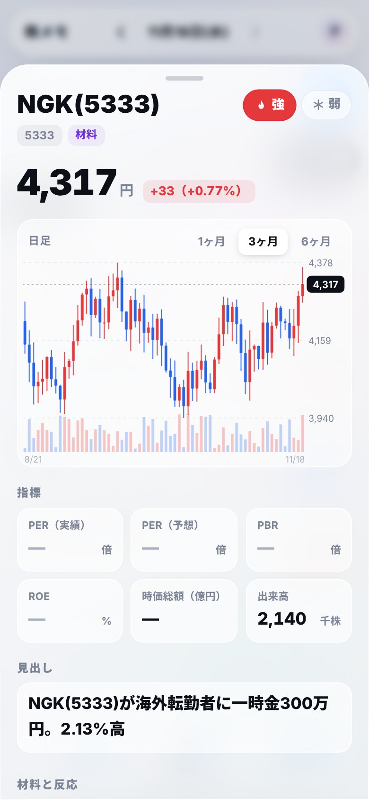
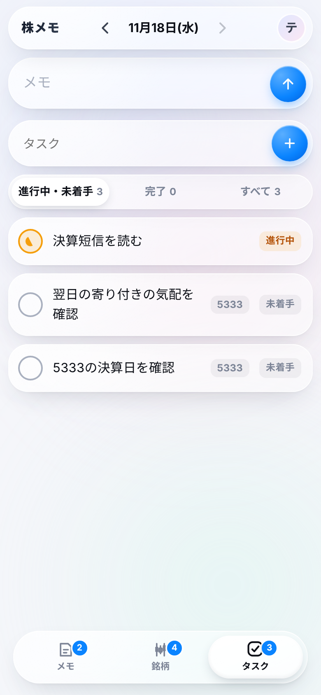
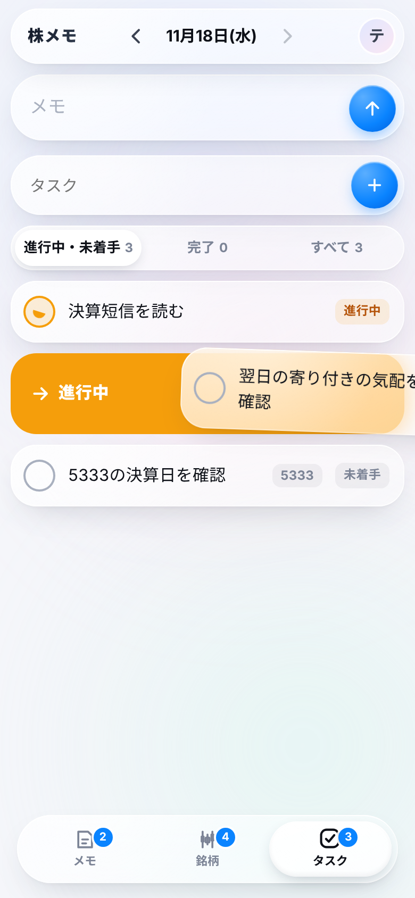
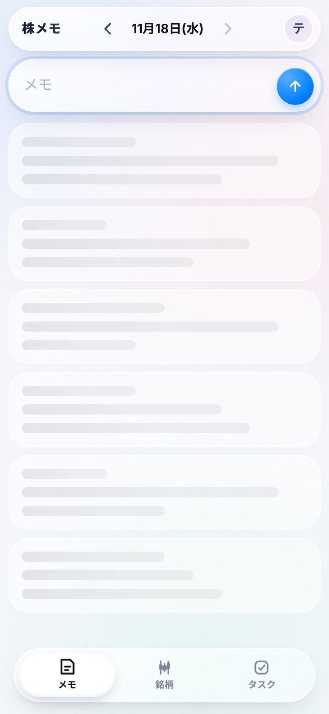

# 株メモ

日本株の取引メモ・銘柄ノート・タスクを1か所で扱うモバイルファーストのWebアプリ。開いた瞬間にメモが書け、Workers AI がメモを「材料と反応」「素直に受け取れない点」に整理する。

| 開いた直後 | メモとAI分析 | 銘柄ノート | 銘柄詳細 |
|---|---|---|---|
|  |  |  |  |

| タスク | フリック中 | 全画面スケルトン |
|---|---|---|
|  |  |  |

## 機能

- **メモ**：開いた瞬間に入力できる。書きかけは打鍵ごとに端末へ保存。⌘/Ctrl+Enter か ↑ボタンで保存。本文から銘柄コード（`5333`、`285A` 形式）を自動抽出。左フリックで削除（取り消し可）、右フリックでAI分析。
- **AI分析**：メモから言及銘柄ごとに「材料と反応」「素直に受け取れない点」「強／弱」「テーマ」、次にやるべきタスク案を生成。ワンタップで銘柄ノートとタスクに取り込める。
- **銘柄ノート**：日付ごとの銘柄一覧（強・弱フィルタ、検索）。詳細に日足ローソク足（1/3/6ヶ月）、PER・PBR・ROE・時価総額・出来高、関連メモ、株探へのリンク。
- **タスク**：右フリックで次の状態（未着手→進行中→完了）、左フリックで前の状態。未着手で左フリックすると削除。
- **同期**：未ログインでも端末に保存。Googleでログインすると自動でサーバーへ同期。

設計の元にしたプロンプトは [docs/PROMPT.md](docs/PROMPT.md)。

## 2つの版

| | 端末保存版 | Cloudflare版 |
|---|---|---|
| 必要な設定 | なし | Cloudflare・Google（下の「デプロイ」） |
| メモ・銘柄ノート・タスク・フリック | ○ | ○ |
| 保存先 | その端末のブラウザだけ | サーバー（D1）。端末間で同期 |
| Googleログイン・AI分析・株価チャート | — | ○ |
| ビルド | `npm run build:local` → `dist-local/` | `npm run build` → `dist/` |

端末保存版は、テスト合格後に自動で `gh-pages` ブランチへ出力される。GitHub の Settings → Pages で「Deploy from a branch」→ `gh-pages` を選ぶと `https://061-ttt.github.io/kabu-memo/` で開ける。どこに置いても動くよう、すべて相対パスで出力している。

## 技術選定と理由

| 領域 | 採用 | 理由 | 比べた候補 |
|---|---|---|---|
| 実行基盤 | **Cloudflare Workers（静的アセット＋API を1つのWorkerで）** | 画面とAPIが同一オリジンになり、CORS不要・クッキーをそのまま使える。`run_worker_first` で `/api/*` `/auth/*` だけWorkerを通し、画面は世界中のエッジから直接返る（速く、無料枠も節約）。デプロイが1回で済む | Cloudflare Pages＋Functions（Cloudflareは新規をWorkersに寄せている）、Vercel等（指定がCloudflare） |
| APIフレームワーク | **Hono** | Workers向けに作られ軽量。型付きルーティング・クッキー操作・ミドルウェアが揃う | itty-router（機能不足）、素の fetch ハンドラ（定型コードが増える） |
| データベース | **D1（SQLite）** | ユーザー・セッション・メモ・タスク・銘柄は関係データ。「持ち主が同じ時だけ・新しい時だけ更新」という条件付きUPSERTを1文のSQLで安全に書ける | KV（結果整合で条件付き書き込み不可）、Durable Objects（この規模には過剰） |
| AI | **Workers AI：`@cf/meta/llama-3.3-70b-instruct-fp8-fast`** | Workers AI の JSON Mode（スキーマ指定の構造化出力）対応モデルの中で日本語の質が最も良い。応答はさらに zod で検証し、壊れていればスキーマなしで再試行して JSON を抜き出す。`AI_MODEL` で差し替え可能 | 外部LLM API（鍵管理と遅延が増える。指定がWorkers AI） |
| ログイン | **OAuth 2.0 認可コード＋PKCE を自前実装（約180行）** | Googleだけなのでライブラリは不要。state は署名付きクッキー、セッションはD1に保存（トークンはSHA-256で保存）するので即時失効できる | Auth.js / better-auth（依存が重い）、JWTセッション（失効できない）、Cloudflare Access（アプリ内ログインにならない） |
| 画面 | **Preact＋TypeScript＋Vite** | Preactは約4KBでReactと同じ書き方。アプリ全体のJSが gzip 約21KB。以前のReactアプリの知識がそのまま使える | React（約45KB）、Svelte/Solid（軽いが書き方が変わる）、素のJS（状態が多く保守が難しい） |
| 開いた瞬間メモ | **静的HTML＋数百バイトのインラインスクリプト** | メモ欄はPreactの描画を待たずHTMLとして最初の描画に入る。JSが届く前の保存は待ち行列に入れ、アプリ起動時に取り込む。Service Workerで2回目以降は通信も待たない | SSR（Workerの処理を待つ）、SPAのみ（JS読み込みまで書けない） |
| 状態管理 | **自作の小さなストア（約140行）** | 依存ゼロ。端末保存（localStorage）と送信キュー（楽観的更新）を同じ場所で扱える | Redux / Zustand（この規模では不要） |
| アニメーション | **CSS＋Web Animations API＋自作のばね計算（約40行）** | ライブラリなしでスワイプのばね、FLIP並び替え、液体タブ、数値カウントを実装。`prefers-reduced-motion` で一括停止 | Framer Motion（約35KB以上） |
| Liquid Glass | **backdrop-filter＋マスクで描く縁の鏡面＋ポインタ追従の反射光＋（Chromiumのみ）SVG屈折** | 白地に淡い光を置いてガラス感を出す。屈折は対応ブラウザだけの段階的強化で、Safariでも崩れない | 画像素材（重い・拡大で荒れる） |
| チャート | **手書きSVGのローソク足** | 必要なのは日足＋出来高だけ。SVGなのでCSSで1本ずつ伸びるアニメーションをかけられる | lightweight-charts（約45KB）、Chart.js（ローソク足は追加プラグイン） |
| 入力検証 | **zod（サーバーのみ）** | APIの入力とAIの出力を同じ仕組みで検証。画面側には載せない | 手書きの検証（漏れやすい） |
| 株価 | **Yahoo Finance のチャートAPI（鍵不要）＋5分キャッシュ（Cache API とメモリ）** | 無料・登録不要で日足と出来高が取れる。※非公式APIのため、仕様変更で取得できなくなる可能性あり。その場合も他機能は動く | J-Quants（公式。無料枠は12週間遅れ・登録が必要。将来の差し替え候補） |
| フォント | **端末のシステムフォント** | Webフォントの読み込み待ちがなく、即時に描画できる | Noto Sans JP 配信（数百KB） |
| テスト | **Vitest（単体）＋Playwright＋実Chrome（E2E）** | E2EはCDPのタッチイベントで指のフリックを再現。Googleは模擬OAuthサーバー（state・PKCE・client_secretを本物同様に検証）、AIと株価は環境変数で模擬に切り替え | Cypress（タッチ操作の再現が弱い） |
| CI/CD | **GitHub Actions＋wrangler 自動プロビジョニング** | テスト合格後に main を自動デプロイ。D1は初回デプロイで自動作成されるので、事前のDB作成やID記入が不要 | Workers Builds（GitHub連携。こちらでも可） |

## 構成

```
src/
  client/       画面（index.html に即時メモ欄、Preact アプリ、Service Worker）
  worker/       API（Hono）・Google OAuth・Workers AI・株価取得
  shared/       銘柄コード抽出・日付（JST）・型
migrations/     D1 スキーマ
tests/unit/     Vitest
tests/e2e/      Playwright：Cloudflare版（模擬 Google OAuth サーバー付き）
tests/e2e-local/ Playwright：端末保存版（サブパス配信の静的サーバー付き）
```

## セキュリティ

- セッション：HttpOnly・Secure・SameSite=Lax のクッキー。DBにはトークンのSHA-256のみ保存。30日・スライディング延長。ログアウトで即失効
- OAuth：state（署名付きクッキー、定数時間比較）、PKCE(S256)、`email_verified` 必須、戻り先は同一オリジンの相対パスのみ
- CSRF：変更系APIとログアウトは Origin を検証
- 認可：全クエリに `user_id` 条件。同じIDで他人のデータを上書きしようとしても 409
- 入力：zod で型・長さ・形式を検証、SQLはすべてプレースホルダ
- AI：1日あたりの回数制限（既定60回）、出力はスキーマ検証後に保存
- CSP：`script-src 'self'` ＋インラインスクリプトのSHA-256ハッシュ（ビルド時に自動計算）、`frame-ancestors 'none'` ほか
- `ALLOWED_EMAILS` を設定すると、指定したアカウントだけがログインできる（個人利用ならAI費用の保護のため設定推奨）

## テスト

```bash
npm ci
npx playwright install chromium   # 初回のみ
npm test                          # 型チェック → 単体 → ビルド → 実ブラウザE2E
```

結果：単体 23件、E2E 37件すべて合格。
- Cloudflare版 31件：受け入れ基準11項目＋セキュリティ・アクセシビリティ。`wrangler dev` をローカルで起動し、ローカルD1・模擬Google・模擬AIで動かす
- 端末保存版 6件：GitHub Pages と同じサブパス配信で、サーバーへ一切通信しないこと、インラインスクリプトが止められても動くことまで確認

## デプロイ（Cloudflare）

1. **Google OAuth クライアントを作る**（[Google Cloud Console](https://console.cloud.google.com/apis/credentials)）
   - 「OAuth同意画面」を作成（外部、テストユーザーに自分を追加）
   - 「認証情報」→「OAuthクライアントID」→ 種類「ウェブアプリケーション」
   - 承認済みのリダイレクトURI：`https://kabu-memo.<あなたのサブドメイン>.workers.dev/auth/callback`
2. **Cloudflare の API トークンを作る**（テンプレート「Edit Cloudflare Workers」＋ D1 編集権限）とアカウントIDを控える
3. **GitHub リポジトリの Settings → Secrets and variables → Actions** に登録
   - `CLOUDFLARE_API_TOKEN`、`CLOUDFLARE_ACCOUNT_ID`
   - `GOOGLE_CLIENT_ID`、`GOOGLE_CLIENT_SECRET`
   - `ALLOWED_EMAILS`（任意。例 `you@gmail.com`）
   - `SESSION_SECRET`（任意。未設定ならデプロイごとに自動生成）
4. main に push（または Actions から再実行）すると、テスト合格後にデプロイされる。D1 は初回に自動作成される

手元から出す場合：`npx wrangler login` → `npm run deploy` → `npx wrangler secret put GOOGLE_CLIENT_ID` など。

## ローカル開発

```bash
npm run e2e:db                                   # ローカルD1を作成
node tests/e2e/mock-google.mjs &                 # 模擬Google
npm run build && npx wrangler dev -c wrangler.e2e.jsonc --persist-to .wrangler/e2e
```

本物のGoogleとWorkers AIで試す場合は `.dev.vars.example` を `.dev.vars` にコピーして値を入れ、`npm run dev`（Workers AI はローカルでもCloudflareに接続するため `wrangler login` が必要）。

## 注意

- iOS Safari はユーザー操作なしにキーボードを開けない仕様のため、開いた直後は「入力欄にカーソルがある状態」まで。ひとタップで書き始められる
- AI分析はメモの内容だけを根拠にした整理で、投資判断の助言ではない
- 株価は非公式APIのため、取得できない時間帯や銘柄がある
