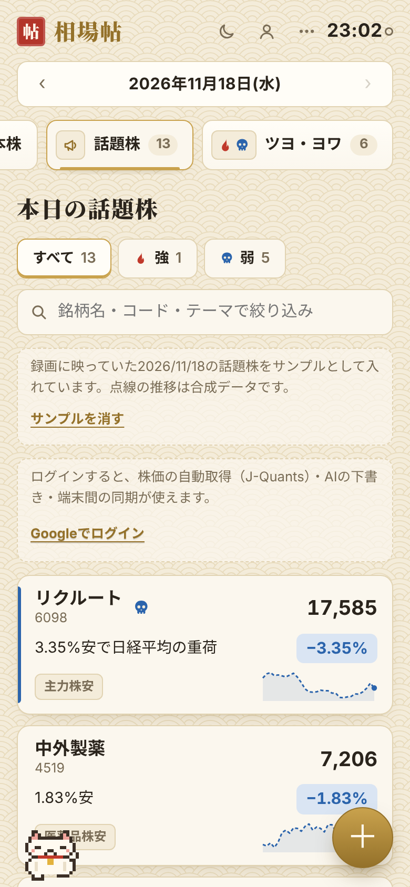
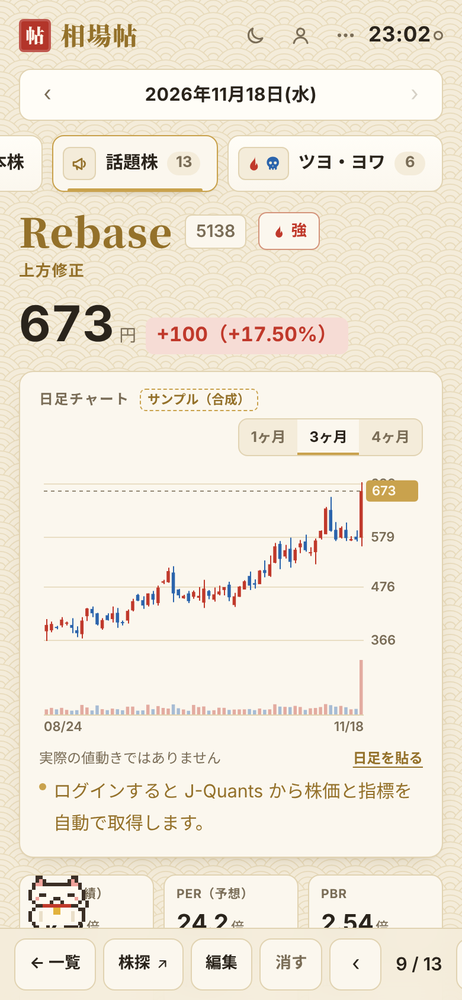
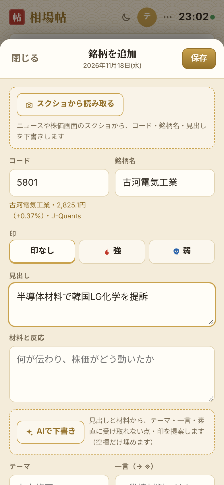
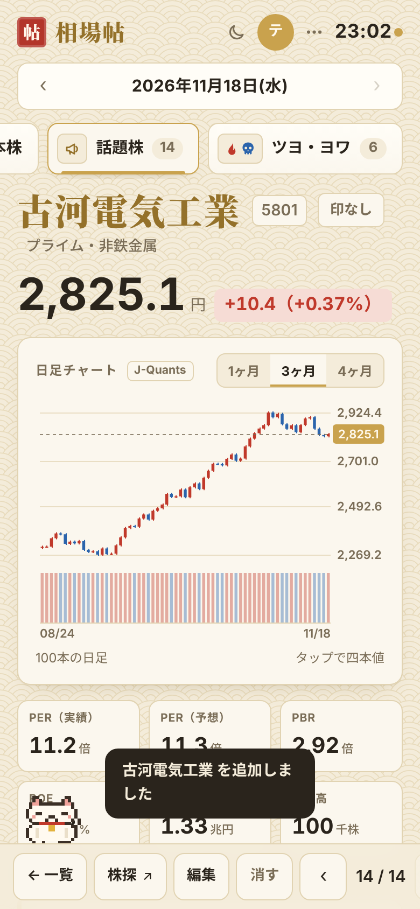
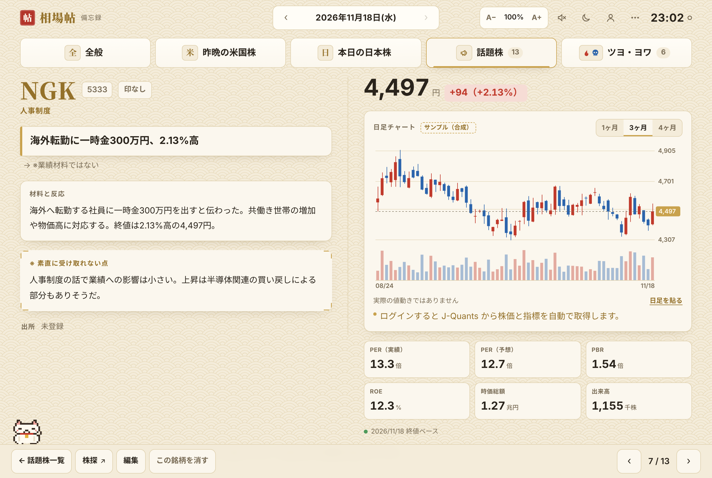

# 相場帖（そうばちょう）

話題株の備忘録。日ごとに「見出し・材料と反応・素直に受け取れない点・強／弱」を書きため、株価・日足・PER などの指標は **J-Quants API（JPX総研）** から自動で入る。モバイルファーストのWebアプリ。

| 一覧 | 詳細（サンプル） | 追加：コードで自動入力 | 詳細（J-Quants） |
|---|---|---|---|
|  |  |  |  |



※ 3・4枚目はテスト用の模擬データ（価格は実在の値ではない）。

## 機能

- **話題株**：日付ごとの一覧。すべて／強／弱の件数チップ、銘柄名・コード・テーマ検索。スマホはカード、PCは表
- **銘柄の詳細**：見出し、→ ※一言、材料と反応、素直に受け取れない点、出所、日足ローソク足（1/3/4ヶ月、タップで四本値）、PER（実績・予想）・PBR・ROE・時価総額・出来高。左右スワイプ（PCは ← →）で前後の銘柄へ。株探へのリンク
- **株価の自動取得**：コードを入れると銘柄名・終値・前日比・日足・指標が入る（J-Quants）。当日分は大引け後（16:30ごろ）の配信まで、前の営業日の値を「配信待ち」と明示して表示
- **全般・昨晩の米国株・本日の日本株**：日ごとのメモ（「・」で箇条書き、「#」で見出し）。全般には指標と話題株の上昇率・下落率上位
- **ツヨ・ヨワ**：強・弱の印をつけた銘柄だけをまとめて表示
- **AI（Workers AI）**：見出しから「テーマ・一言・素直に受け取れない点・印」を下書き（空欄だけ埋める）。ニュースや株価画面のスクショからコード・銘柄名・見出しを読み取り
- **同期**：未ログインでも端末に保存して動く。Googleでログインすると端末のデータをサーバーへ送り、以後は端末間で同期
- そのほか：文字サイズ、効果音、ダークモード、画面下を歩く招き猫「こばん」（タップで表示中の銘柄の注意点を話す）、JSONのバックアップ、ホーム画面への追加（PWA）

初回は、参考の録画に映っていた 2026/11/18 の話題株13件をサンプルとして表示する（一覧の「サンプルを消す」で消せる）。
設計の元にしたプロンプトは [docs/PROMPT.md](docs/PROMPT.md)。

## 株価データ（J-Quants API）

| プラン（税込） | 月額 | 当日の日足 | 期間 |
|---|---|---|---|
| Free | 0円 | ×（12週間遅れ） | 過去2年 |
| Light | 1,650円 | ○（大引け後に更新） | 過去5年 |
| Standard | 3,300円 | ○ | 過去10年 |

その日の話題株に使うなら **Light 以上**。使うエンドポイントは `/equities/bars/daily`（日足）、`/equities/master`（銘柄名）、`/equities/valuation`（PER・PBR・ROE・時価総額）。
J-Quants API は**個人の私的利用**に限られるため、`ALLOWED_EMAILS` に自分のアドレスだけを入れて公開しないこと。

取得の工夫：

- 取った日足・指標・銘柄名は D1 に貯める（全ユーザー共通のキャッシュ）。同じ銘柄を何度開いても J-Quants へは取りに行かない
- 当日分は 16:30 以降に取りに行き、まだ無ければ10分おきに取り直す。配信時刻から6時間たっても無い日は休場日とみなして止める
- 分割・併合は調整済みの値でチャートを描き、画面の終値は調整前の値を出す
- キー未設定・プラン外（403）・回数制限（429）は理由を画面に出し、手入力の値で表示を続ける（指標がプランで取れない場合は空欄になり、手入力できる）
- `JQUANTS_API_KEY` が無いときだけ、予備として Yahoo Finance の非公式チャートAPIを使う

## 2つの版

| | 端末保存版 | Cloudflare版 |
|---|---|---|
| 必要な設定 | なし | Cloudflare・Google・J-Quants（下の「デプロイ」） |
| 一覧・詳細・メモ・ツヨヨワ・こばん | ○ | ○ |
| 株価 | 手入力・日足CSVの貼り付け（無ければ合成のサンプル） | J-Quants から自動 |
| 保存先 | その端末のブラウザだけ | サーバー（D1）。端末間で同期 |
| Googleログイン・AI | — | ○ |
| ビルド | `npm run build:local` → `dist-local/` | `npm run build` → `dist/` |

端末保存版は、テスト合格後に自動で `gh-pages` ブランチへ出力される。GitHub の Settings → Pages で「Deploy from a branch」→ `gh-pages` を選ぶと `https://061-ttt.github.io/kabu-memo/` で開ける。

## 技術選定と理由

| 領域 | 採用 | 理由 |
|---|---|---|
| 実行基盤 | **Cloudflare Workers（静的アセット＋APIを1つのWorkerで）** | 画面とAPIが同一オリジン。`run_worker_first` で `/api/*` `/auth/*` だけWorkerを通す |
| API | **Hono＋zod** | 入力とAIの出力を同じ仕組みで検証 |
| データベース | **D1** | 話題株・メモは「持ち主が同じ時だけ・新しい時だけ更新」の条件付きUPSERT。差分同期はサーバー時刻（`server_at`）をカーソルにする |
| 株価 | **J-Quants API V2**＋D1キャッシュ | 公式の個人向けAPI。日足・銘柄名・バリュエーション指標がそろう |
| AI | **Workers AI**：下書き `@cf/meta/llama-3.3-70b-instruct-fp8-fast`（JSONスキーマ）、スクショ `@cf/google/gemma-4-26b-a4b-it`（画像入力） | `AI_MODEL` / `AI_VISION_MODEL` で差し替え可能 |
| ログイン | **OAuth 2.0 認可コード＋PKCE（自前実装）** | セッションはD1（トークンはSHA-256で保存）で即時失効できる |
| 画面 | **素のJavaScript（フレームワークなし）**＋Vite | 1画面の道具なので状態は小さい。JSは gzip 約27KB |
| チャート | **Canvas の手書きローソク足** | 日足＋出来高＋四本値の表示だけなので軽く作れる |
| フォント | **端末のシステムフォント**（明朝はヒラギノ明朝など） | Webフォントの読み込み待ちがない |
| テスト | **Vitest＋Playwright（実Chrome）** | 模擬 Google OAuth・模擬 J-Quants（APIキーとページングまで本物と同じ形）・模擬AIで通しで確かめる |
| CI/CD | **GitHub Actions** | テスト合格後に main を自動デプロイ。D1は初回に自動作成、マイグレーションも自動適用 |

## 構成

```
src/
  client/       画面（index.html・app.js・styles.css、Service Worker、アイコン）
  worker/       API（Hono）・Google OAuth・J-Quants（jquants.ts / quote.ts）・Workers AI
  shared/       銘柄コード・日付（JST）・型
migrations/     D1 スキーマ（0002 で相場帖のテーブルを追加。以前のテーブルは消さない）
tests/unit/     Vitest
tests/e2e/      Playwright：Cloudflare版（模擬 Google・模擬 J-Quants 付き）
tests/e2e-local/ Playwright：端末保存版（サブパス配信）
```

## セキュリティ

- セッション：HttpOnly・Secure・SameSite=Lax のクッキー。DBにはトークンのSHA-256のみ。30日・スライディング延長
- OAuth：state（署名付きクッキー）、PKCE(S256)、`email_verified` 必須、戻り先は同一オリジンの相対パスのみ
- CSRF：変更系APIとログアウトは Origin を検証
- 認可：全クエリに `user_id` 条件。他人と同じIDで送っても 409
- 入力：zod で型・長さ・形式（コード・日付・URLは http/https のみ・画像は data:image のみ）を検証、SQLはすべてプレースホルダ
- J-Quants の APIキーは Worker の secret だけに置き、画面には出さない
- AI：1日あたりの回数制限（既定60回）、出力はスキーマ検証してから返す
- CSP：`script-src 'self'`、`frame-ancestors 'none'` ほか

## テスト

```bash
npm ci
npx playwright install chromium   # 初回のみ
npm test                          # 型チェック → 単体 → ビルド → 実ブラウザE2E
```

結果：単体 31件、E2E 21件すべて合格（Cloudflare版19件・端末保存版2件）。README の画面写真は `SCREENS=1 npx playwright test tests/e2e/99-screens.spec.ts --project=full` で撮り直せる。

## デプロイ（Cloudflare）

1. **J-Quants の APIキーを作る**（[J-Quants](https://jpx-jquants.com/)）：登録してプランを選び（当日の値が要るなら Light 以上）、ダッシュボードで APIキーを発行
2. **Google OAuth クライアントを作る**（[Google Cloud Console](https://console.cloud.google.com/apis/credentials)）
   - 「OAuth同意画面」を作成（外部、テストユーザーに自分を追加）
   - 「認証情報」→「OAuthクライアントID」→ 種類「ウェブアプリケーション」
   - 承認済みのリダイレクトURI：`https://kabu-memo.<あなたのサブドメイン>.workers.dev/auth/callback`
3. **Cloudflare の API トークンを作る**（テンプレート「Edit Cloudflare Workers」＋ D1 編集権限）とアカウントIDを控える
4. **GitHub リポジトリの Settings → Secrets and variables → Actions** に登録
   - `CLOUDFLARE_API_TOKEN`、`CLOUDFLARE_ACCOUNT_ID`
   - `GOOGLE_CLIENT_ID`、`GOOGLE_CLIENT_SECRET`
   - `JQUANTS_API_KEY`
   - `ALLOWED_EMAILS`（自分のアドレス。例 `you@gmail.com`）
   - `SESSION_SECRET`（任意。未設定ならデプロイごとに自動生成）
5. main に push（または Actions から再実行）すると、テスト合格後にデプロイされる。D1 は初回に自動作成され、マイグレーションも適用される

手元から出す場合：`npx wrangler login` → `npm run deploy` → `npx wrangler secret put JQUANTS_API_KEY` など。

## ローカル開発

```bash
npm run e2e:db                                   # ローカルD1を作成
node tests/e2e/mock-google.mjs &                 # 模擬Google
node tests/e2e/mock-jquants.mjs &                # 模擬J-Quants
npm run build && npx wrangler dev -c wrangler.e2e.jsonc --persist-to .wrangler/e2e
```

本物で試す場合は `.dev.vars.example` を `.dev.vars` にコピーして値を入れ、`npm run dev`（Workers AI はローカルでもCloudflareに接続するため `wrangler login` が必要）。

## 注意

- 投資助言ではない。AI の下書きは書いた内容だけを根拠にした整理
- 以前の版「株メモ」（メモ・タスク）のデータは D1 の `memos` / `tasks` / `picks` テーブルにそのまま残っている。コードは git の履歴（コミット b28b1f0）から戻せる
